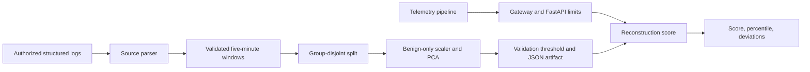

# SecurityLogAnomalyDetector

Unsupervised anomaly scoring for five-minute windows of Linux, Windows, cloud audit, application, and authentication logs. The project fits a PCA reconstruction baseline on benign windows, returns continuous scores and feature deviations, and includes pluggable local JSONL parsers, FastAPI inference, Docker, tests, and CI.

## Overview

This service highlights log activity that differs from a reviewed benign baseline. A high anomaly score is an investigation lead, not evidence of an attack. Analysts should combine it with source logs, asset context, and other controls.

## Features

- Source-specific parsers for five structured log formats with a shared normalized event schema.
- Private five-minute aggregation that omits raw messages, principals, hosts, and source IDs from the training CSV.
- Group-disjoint train/validation/test splits, benign-only scaling and PCA, and validation-only threshold selection.
- Strict non-executable JSON artifact with feature order, checksum, version, and held-out metadata.
- Bounded authenticated FastAPI, structured logs, Prometheus metrics, Docker, and CI.

## Architecture



## How It Works

`scripts/prepare_logs.py` accepts local JSONL in one of five documented formats, maps selected fields to a common event record, and aggregates by source and five-minute UTC bucket. It ignores free-form message bodies. A per-run keyed hash becomes `group_id`, keeping all windows from one source in one partition. Training validates numeric windows, fits a scaler and PCA on benign training rows, selects a threshold from benign validation scores, and evaluates once on untouched labeled test rows. Inference compares a submitted window with the saved baseline.

## Machine Learning Approach

`StandardScaler` and PCA model relationships among benign log-window features. Mean squared reconstruction error is the anomaly score. The configured benign validation quantile sets `anomaly_flag`; `baseline_percentile` compares the score with validation quantiles. These are not calibrated probabilities. The five largest squared residuals identify deviating features, not root causes.

## Dataset

No dataset is bundled or downloaded. The academic [Loghub collection](https://github.com/logpai/loghub) includes research Linux, Windows, and other system logs; review each source's license, format, privacy, and citation terms. The [LANL ARCS datasets](https://csr.lanl.gov/data/) are another official source of de-identified host and authentication events. Most raw logs do not directly provide this project's reviewed anomaly labels or historical rates. Operators must curate authorized structured events and labels into the schema in `data/README.md`. The synthetic fixture is only a smoke test.

## Features Used

Inputs: source type, events per minute, error/auth-failure/access-denied ratios, distinct event codes/principals/hosts, off-hours and rare-template ratios, mean severity, interval burstiness, mean interarrival seconds, privileged-action count, and historical expected event rate. Source type becomes five indicator features. Derived features are activity-to-baseline ratio, failure volume, and privileged-action rate. Historical expected rate and rare-template flags must use information available before the window.

## Model Training

`configs/training.json` sets seed, split fractions, PCA components, benign quantile, and dataset size limits. Training rejects missing, out-of-range, non-finite, conflicting duplicate, and unsupported-label rows. `group_id` keeps a source out of multiple partitions. The trainer writes `models/model.json` and `models/model.metadata.json`, including dataset SHA-256, configuration, split counts, fit policy, threshold source, held-out metrics, and model version. Artifacts are ignored by Git.

## Model Evaluation

The test set retains its natural benign/anomalous distribution. Inspect results by log source, asset class, and later time periods before deployment. A synthetic test proves only that the pipeline runs. Benign contamination, logging changes, and uneven parser coverage can invalidate a baseline.

## Metrics

Held-out metrics include precision, recall, F1, ROC-AUC, PR-AUC, false-positive rate, false-negative rate, confusion matrix, and class support. `/metrics` exposes aggregate requests, predictions, inference errors, and latency. No benchmark score is claimed without reviewed source data.

## API

`GET /health`, `GET /ready`, `GET /version`, `GET /metrics`, `POST /api/v1/predict`, and `POST /api/v1/batch-predict`. Requests contain `observation` or `observations`; responses contain `anomaly_score`, `anomaly_flag`, `threshold`, `baseline_percentile`, `risk_score`, `model_version`, and `top_feature_deviations`. `/ready` returns 503 without a valid model. Inference and metrics require `X-API-Key` when configured; production mode requires a strong key. Put tenant identity and authorization at a gateway.

## Installation

From a fresh clone with Python 3.12+:

```bash
git clone https://github.com/Arjunren/SecurityLogAnomalyDetector.git
cd SecurityLogAnomalyDetector
python -m venv .venv
# Activate .venv using your shell's standard command.
python -m pip install -e ".[dev]"
pre-commit install
```

## Configuration

Copy `.env.example` to `.env`, configure the API key, model path, and limits, and review `configs/training.json`. Protect source logs, processed windows, and artifacts in approved storage. The embedded SHA-256 checks integrity but is not a release signature.

## Environment Variables

| Variable | Purpose | Default |
| --- | --- | --- |
| `APP_ENV` | `development`, `test`, or `production` | `development` |
| `LOG_LEVEL` | Structured logging level | `INFO` |
| `MODEL_PATH` | JSON artifact path | `models/model.json` |
| `API_HOST`, `API_PORT` | Local bind values | `127.0.0.1`, `8000` |
| `API_KEY` | Shared inference/metrics key | empty in development |
| `MAX_BATCH_SIZE` | Maximum windows per call | `100` |
| `MAX_REQUEST_BYTES` | JSON body cap | `1048576` |
| `MAX_CONCURRENT_INFERENCE` | Worker/admission cap | `4` |
| `INFERENCE_TIMEOUT_SECONDS` | Queue and response timeout | `2` |

## Running Locally

For a self-contained smoke run, generate synthetic windows and train, then start `make serve` or `uvicorn security_log_anomaly_detector.api:app --host 127.0.0.1 --port 8000`. For real data, prepare one source format at a time. The service loads its model at startup and does not contact any source host or cloud endpoint during inference.

## Running with Docker

Train first, set `APP_ENV=production` and a strong `API_KEY` in `.env`, then run `docker compose build && docker compose up`. Docker runs non-root; Compose uses a read-only filesystem, dropped capabilities, a health check, and CPU/memory/process limits. Put TLS, per-client rate limits, and identity/authorization at a gateway.

## Training the Model

```bash
python scripts/prepare_logs.py --format linux --input data/raw/reviewed_linux.jsonl --output data/processed/log_windows.csv
security-log-anomaly-detector train --dataset data/processed/log_windows.csv --model models/model.json --config configs/training.json --version 1.0.0
```

Choose `windows`, `cloud`, `application`, or `authentication` for the other parser schemas. To smoke-test without source logs, run `python scripts/generate_test_data.py` and train on `data/processed/synthetic.csv`. Do not concatenate separately prepared CSVs without assigning consistent source groups and reviewing labels. Assign a new semantic model version after retraining or changing features.

## Running Inference

```bash
security-log-anomaly-detector predict --observation examples/observation.json
security-log-anomaly-detector evaluate
```

## API Examples

```bash
curl -H 'Content-Type: application/json' -H 'X-API-Key: replace-with-configured-key' \
  -d '{"observation":{"source_type_code":0,"events_per_minute":4,"error_ratio":0.05,"auth_failure_ratio":0.02,"access_denied_ratio":0.01,"distinct_event_codes":6,"distinct_principals":3,"distinct_hosts":1,"off_hours_ratio":0.1,"rare_template_ratio":0.05,"mean_severity":3,"burstiness":0.8,"mean_interarrival_seconds":15,"privileged_action_count":0,"baseline_expected_events_per_minute":4.5}}' \
  http://127.0.0.1:8000/api/v1/predict
```

Batch requests use `{"observations":[{...},{...}]}`. Submit aggregate numeric windows only; exclude raw messages, user IDs, hostnames, and tokens.

## Testing

Run `make lint`, `make typecheck`, `make test`, and `make security`. Tests cover all five parser mappings, identifier removal, feature validation, grouped splitting, training and artifact round-trip, corrupted artifacts, API health/authentication, malformed requests, oversized bodies, and excessive batches. Fixtures are synthetic and offline.

## Security

Logs, labels, JSONL, CSV rows, HTTP bodies, and artifacts are untrusted. Parser input is bounded by bytes, rows, and line length; free-form messages are discarded. API limits body, batch, concurrency, and time. Strict JSON artifacts avoid pickle. Logs and metrics omit raw messages, identifiers, keys, and payloads. The service has no outbound request driven by log content. See `docs/security.md`.

## Project Structure

`src/security_log_anomaly_detector/` holds schemas, PCA training, artifact, CLI, configuration, and API. `scripts/` has source-specific parsers and synthetic fixtures. `configs/`, `data/`, `models/`, `examples/`, `docs/`, `notebooks/`, `tests/`, and `.github/workflows/` separate configuration, artifacts, examples, documentation, verification, and CI.

## Monitoring and Observability

Scrape authenticated `/metrics` with Prometheus and graph latency, errors, and prediction volume in Grafana. Monitor score drift, parser failure rates, log coverage, and analyst-confirmed outcomes in a privacy-safe pipeline. Never use principals, hosts, message bodies, or source IDs as metric labels.

## Limitations

PCA captures linear structure in aggregate windows and cannot prove malicious intent or inspect full event sequences. Legitimate incidents and maintenance can be anomalous; quiet attacks may resemble baseline. Parser mappings depend on upstream schemas and reviewed flags. Future-derived historical rates or contaminated benign labels cause leakage. The percentile is not a compromise probability. Shared API keys lack tenant-level authorization.

## Future Improvements

Add time-forward evaluation, source-specific baselines, reviewed sequence features, drift alarms, more format adapters, and trusted artifact signing. Keep parser resource bounds and privacy controls as integrations expand.

## Responsible Use

Use anomaly scores as investigation leads with analyst review. Do not automatically block users, hosts, or services based on this score. Respect dataset terms, retention policies, and local privacy rules; never commit raw logs or model artifacts.

## Contributing

Submit reproducible issues or focused pull requests with synthetic fixtures. Run quality gates and document parser or feature-schema changes. Do not include private logs, credentials, or trained models.

## License

Code is MIT licensed. External datasets remain governed by source terms.
