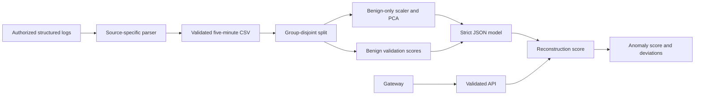

# Architecture

## Components and data flow

The local parser selects one of five known source schemas, drops free-form messages, and aggregates events by source and five-minute UTC bucket. A keyed group hash keeps related windows together. Training validates numeric rows and labels, rejects conflicting feature duplicates, fits scaling and PCA only on benign training rows, derives threshold and score quantiles from benign validation rows, and evaluates on untouched test rows. The API loads the reviewed artifact at startup and scores bounded numeric requests.

## Trust boundaries

Raw logs, labels, historical baselines, CSVs, HTTP bodies, API keys, and model artifacts are untrusted. Upstream collection must strip tokens and protect identifiers. The parser never executes log content or contacts logged IPs. The API receives only aggregates. A gateway handles TLS, per-client identity, tenant authorization, and rate limits; the shared API key is an additional gate.

## Model lifecycle and deployment

Version feature schema and artifact together. Track dataset SHA-256, parser mapping, training configuration, split support, and score drift. Review source licensing and contamination before promotion. Store artifacts in trusted release storage; the JSON checksum is not a signature. Docker serves a pre-trained model non-root with a read-only filesystem, while Prometheus/Grafana consume aggregate service metrics.
